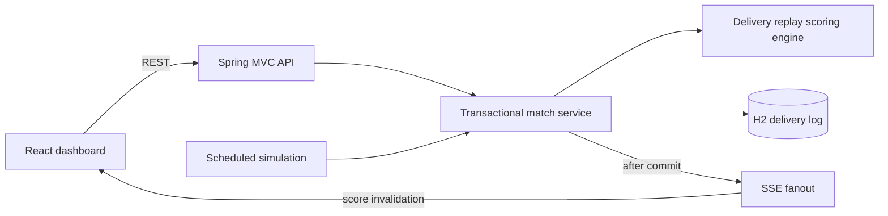

# CREASE — live cricket match centre

Web Technology Assignment 7. Spring Boot REST APIs and a React dashboard for **simulated** live T20 cricket. Fixtures, results, and player statistics are fictional. No sports API key is required.

**GitHub:** [coder-crypt0/wtassign — assign7](https://github.com/coder-crypt0/wtassign/tree/assign7)

**Evaluation report:** [Download the Word report with screenshots](docs/Assignment7_Crease_Report.docx).

## Run for evaluation

Install **Java 21**, **Maven 3.9+**, and **Node.js 22.12+ LTS**. Open PowerShell in the project root:

```powershell
powershell -ExecutionPolicy Bypass -File .\run.ps1
```

The launcher checks prerequisites and the port, installs locked dependencies, builds React, bundles it inside Spring Boot, waits for health, and opens **http://127.0.0.1:8087**. No separate frontend server is needed. Keep the terminal open; **Ctrl+C stops the server**. Internet is needed for the first dependency download.

```powershell
.\run.ps1 -Test         # Backend + desktop and mobile browser tests, then exit
.\run.ps1 -FreshDemo    # Temporary session; preserves existing saved data
.\run.ps1 -Port 8090    # Choose another application port
.\run.ps1 -NoBrowser    # Start without opening a browser
.\run.ps1 -BuildOnly    # Build the executable JAR, then exit
```

`-Test` starts a separate server on **8088** with an isolated in-memory database and scheduled scoring disabled. It installs Playwright Chromium on the first run. Stop Vite before running the launcher: Windows locks its native dependency while in use. Normal launch logs are in `.run/server.log` and `.run/server-error.log`.

### Evaluation walkthrough

1. Watch India vs Australia or England vs South Africa update every eight seconds.
2. Open **Scorer's desk**, pause auto-play, record a four, wide, or no-ball, then undo a delivery.
3. Switch scorecard innings and filter ball-by-ball commentary to boundaries or wickets.
4. Search for a team or venue, bookmark a match, and explore Schedule and Player index.
5. Resize to a phone width; navigation moves to the bottom. Bookmarks survive a reload.

Finished live fixtures can be replayed through **Scorer's desk → Restart this simulation**. Confirmation restores the original checkpoint and pauses auto-play. Upcoming and archived fixtures are read-only.

## Features

- Six fictional fixtures: live, upcoming, and completed, with full squads.
- Persisted delivery log, batting/bowling scorecards, commentary, targets, run rates, partnerships, falls of wickets, and cumulative-run charts.
- Server-sent events, heartbeats, reconnection recovery, and a 20-second recovery refresh.
- Runs, bowler's wickets, wides, no-balls, strike rotation, free hits, innings transitions, and chase completion.
- Pause/resume, exact replay-based undo, and restartable live demos.
- Idempotent delivery UUIDs, match row locking, and revision checks for competing scorers.
- Search, browser-persisted bookmarks, schedule, and tournament player leaders.
- Responsive editorial UI, local fonts, custom field artwork, native dialog focus management, and reduced-motion support.

## Architecture

```text
run.ps1                           Evaluation launcher
backend/pom.xml                   Spring Boot and Java 21
backend/src/main/java/com/crease/
  api/                            REST endpoints and validation errors
  domain/                         Match, delivery, team and player models
  repository/                     JPA persistence and match row locking
  service/                        Scoring, seeding, simulation and SSE
backend/src/test/                  Scoring rules and API integration tests
frontend/src/                     React, TypeScript, UI and CSS
frontend/e2e/                     Playwright functional browser tests
docs/                             Word report and actual app screenshots
```



Each write locks the match row and checks `expectedRevision`. Two competing scorers cannot overwrite each other: one succeeds and the stale request gets HTTP 409. UUIDs make delivery retries idempotent. Streaming events publish after commit. Collection queries batch-load deliveries; fanout uses Java 21 virtual threads, caps subscribers and in-flight sends at 256, and removes failed clients.

**Scale boundary:** this assignment runs as one instance with an embedded database and one scheduler. It is not a benchmarked distributed service. Horizontal deployment would need an external relational database, an elected simulation worker, and shared event transport such as Redis or Kafka. API, scoring, storage, and streaming are separated to support that migration.

## REST API

| Method | Endpoint | Purpose |
| --- | --- | --- |
| GET | `/api/matches` | Fixtures; optional `?status=LIVE`, `UPCOMING`, or `COMPLETED` |
| GET | `/api/matches/{id}` | Summary and complete innings data |
| GET | `/api/players` | Batting and bowling leaders |
| GET | `/api/live` | SSE: `connected`, `score`, `heartbeat` |
| POST | `/api/matches/{id}/deliveries` | Record a delivery |
| DELETE | `/api/matches/{id}/deliveries/latest?expectedRevision=0` | Undo and pause |
| PATCH | `/api/matches/{id}/simulation` | Enable or pause automatic scoring |
| POST | `/api/matches/{id}/restart` | Restore a live demo checkpoint |
| GET | `/actuator/health` | Application/database health |

Example delivery (use the latest revision from GET):

```json
{
  "requestId": "5fce23d0-f03c-4d79-8ceb-31b48d78ac0c",
  "outcome": "RUN",
  "runs": 4,
  "expectedRevision": 0
}
```

Outcomes: `RUN`, `WICKET`, `WIDE`, `NO_BALL`. Runs must be 0–6; a bowler's wicket requires zero runs. Wides add `runs + 1` to extras. No-balls add one extra plus runs off the bat. Neither consumes a legal delivery. A no-ball grants a free hit, which survives wides.

Simulation body: `{"enabled":false,"expectedRevision":0}`. Restart body: `{"expectedRevision":0}`. Error responses contain `status`, `message`, and `path`. Validation errors return 400, unknown matches 404, and stale or invalid-state writes 409.

This simplified scoring model supports bowler's wickets. Run-outs, byes, leg-byes, penalty runs, reviews, rain rules, super overs, and wicket subtypes are outside its scope. Batter balls faced count legal deliveries.

## Development and testing

```powershell
# Terminal 1, from backend/
mvn spring-boot:run

# Terminal 2, from frontend/
npm ci
npm run dev
```

Open **http://127.0.0.1:5173**. Vite proxies `/api` and `/actuator` to port 8087.

`mvn test` in `backend/` runs scoring and API tests. `npm run build` in `frontend/` type-checks and builds React. The complete **`.\run.ps1 -Test`** sequence packages the frontend first, then runs Playwright against the executable JAR.

Coverage includes scoring/strike rules, extras, free hits, over limits, chase completion, undo/restart, validation, idempotency, concurrent writes, SSE updates, search, bookmarks, scorecards, commentary, player leaders, and mobile overflow checks.

## Configuration and data

| Environment variable | Default | Meaning |
| --- | --- | --- |
| `PORT` | `8087` | Port; launcher `-Port` takes precedence |
| `SERVER_ADDRESS` | `127.0.0.1` | Loopback binding |
| `DB_URL` | `jdbc:h2:file:./data/crease;DB_CLOSE_ON_EXIT=FALSE` | JDBC URL, relative to backend working directory |
| `DB_USER` | `sa` | Database user |
| `DB_PASSWORD` | empty | Database password |
| `SIMULATION_ENABLED` | `true` | Enable scheduled simulator |
| `SIMULATION_INTERVAL_MS` | `8000` | Delay between automatic deliveries |

Seeding happens only when the database is empty. Saved data survives restarts. `-FreshDemo` uses a separate temporary session without deleting saved files. Databases, logs, dependencies, build output, and browser traces are Git-ignored.

This is a locally bound academic demo with unauthenticated scorer endpoints. Add authentication, scorer roles, request limits, migrations, and production database configuration before exposing it to a network. Scores come from the local simulation, not a commercial cricket provider.
